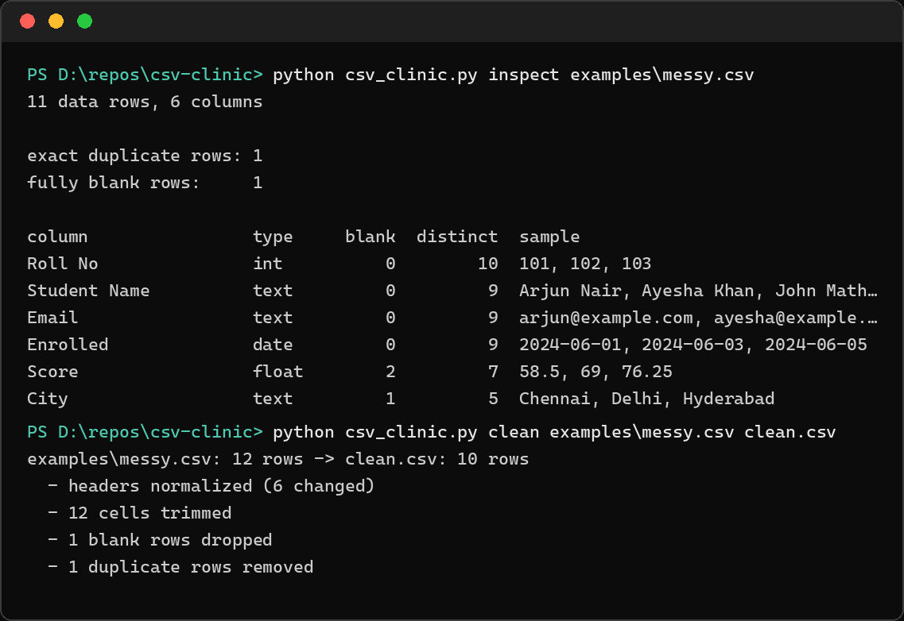

# csv-clinic

[](https://github.com/amanvicky/csv-clinic/actions/workflows/ci.yml)

Diagnose and clean messy CSVs from the terminal — **zero dependencies**, stdlib `csv` only. The first tool every data student needs, before pandas, before notebooks, before the spreadsheet with 40 hidden spaces in it.



## inspect — what's wrong with this file

```bash
python csv_clinic.py inspect examples/messy.csv
```

Per column: the narrowest type every value fits (`int` → `float` → `date` → `text`), blank count, distinct count and a sample. Per file: exact duplicate rows, fully blank rows. The shot above is the repo's own messy student roster — trailing spaces, one blank row, one duplicate, two missing scores — and `inspect` finds all of it in one pass.

## clean — fix the boring parts, report everything

```bash
python csv_clinic.py clean examples/messy.csv clean.csv
```

```
examples\messy.csv: 12 rows -> clean.csv: 10 rows
  - headers normalized (6 changed)      # "Student Name  " -> "student_name"
  - 12 cells trimmed
  - 1 blank rows dropped
  - 1 duplicate rows removed
```

Every change is listed, and each one has an opt-out (`--keep-headers`, `--keep-empty`, `--keep-duplicates`, `--no-trim`) — the tool never does something you can't see or undo. Ragged rows get padded to the header width.

## convert

```bash
python csv_clinic.py convert in.csv out.tsv --tsv
```

## Run

```bash
git clone https://github.com/amanvicky/csv-clinic
cd csv-clinic
python csv_clinic.py inspect examples/messy.csv
pytest tests/ -q      # 8 tests, stdlib only
```

## Why it exists

Every dataset I touched in [Genesis](https://github.com/amanvicky/Genesis-Business-Decoding-Engine), [leyp](https://github.com/amanvicky/leyp) and the [SQL drills](https://github.com/amanvicky/SQL) started with the same hour of fixing headers and hunting duplicate rows. This is that hour, compressed into one command — built for students who meet their first messy CSV before they meet pandas.
